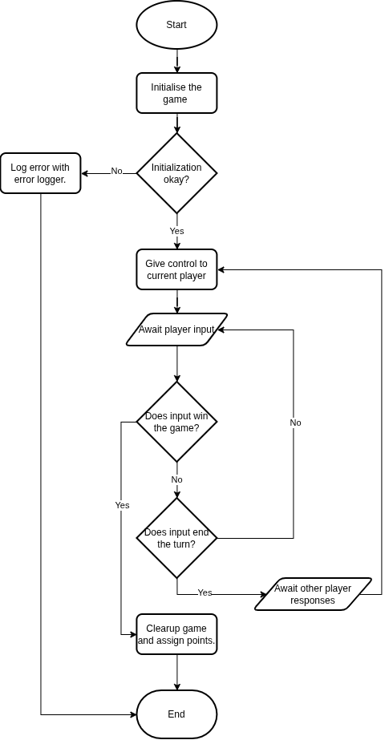

# Card Engine

## Description

An interface for implementing player and card functionality. The card engine should handle game flow as well as be modular enough to implement many different games via the GameRules interface without having to embed game logic within the engine itself.

## Objects

In order to simulate a card game, we require the following objects:
- CardFunctions
- GameRoom
- Game
- Player
- PlayerList
- Card
- CardStack
- DealStack
- DiscardStack
- GameRules

### CardFunctions
The CardFunctions object has the following definition.
```csharp
class CardFunctions {
  int send(Card sourceCard, CardStack targetStack);
  int sendToPosition(Card sourceCard, CardStack targetStack, int index);
  int swap(Player sourcePlayer, int sourceIndex, Player targetPlayer, int targetIndex);
  int shuffle(CardStack stack);
}
```

- *send* transfers a card *sourceCard* to a card stack *targetStack*.
- *sendToPosition* transfers a card *sourceCard* to a card stack *targetStack* at the index *index*.
- *swap* moves the card at index *sourceIndex* of player *sourcePlayer* to the player of *targetPlayer* and conversely transfers the card at index *targetIndex* to the original location of the source card.
- *shuffle* takes a card stack *cardStack* and shuffles the order of the cards in the stack.

### GameRoom
The GameRoom object has the following definition.
```csharp
class GameRoom {
  int id;
  Player[] activePlayers;
  Game game;
}
```

- *id* is a uniquely defined integer which references the game room.
- *activePlayers* is an array of players who are actively playing in the game room.
- *game* is the instance of the current game being played in the game room.

### Game
The Game object has the following definition.
```csharp
class Game {
  GameRules gameRules;
  int start();
  int init();
  int turn();
  int next();
  int end();
}
```

- *start* is a function which starts the game.
- *init* is a function which initialises the player order, player cards and table setup.
- *turn* is a function that implements the current game rules *gameRules* for the player.
- *next* is a function that handles the passing of a turn.
- *end* is a function that stops the game.

### Player
The Player object has the following definition.
```csharp
class Player {
  string username;
  int score;
  CardStack hand;
  int getCard(int index);
  int setCard(int index, Card card);
  int removeCard(int index);
  int addCard(Card card);
  int addCardToPosition(Card card, int index);
  int getHand();
  int swapCard(int currentIndex, Player targetPlayer, int targetIndex);
  int sendCard(int index, CardStack targetStack);
  int sendCardToPosition(int sourceIndex, CardStack targetStack, int targetIndex);
}
```

- *username* is the current player's username.
- *score* is the total number of points earned for the current game room.
- *hand* is the player's card stack.
- *getCard* is a function that takes *numberOfCards* number of cards from the stack *targetStack*.
- *removeCard* is a function that removes all *sourceCards* and moves them to the stack *targetStack*.
- *swapCard* is a function that swaps the player's *sourceCard* with another player's *targetCard*.
- *addCard* is a function that adds a card *card* to the player's hand.
- *addCardToPosition* is a function that adds a card *card* to a player's hand at the index *index*.
- *sendCard* is a function that moves a player's *sourceCard* to a stack *targetStack*.
- *sendCardToPosition* is a function that moves a player's card at *sourceIndex* to a player *targetPlayer* at location *targetIndex*.


### Card
The Card object has the following definition.
```csharp
class Card {
  int value;
  char suit;
  bool isHidden;
}
```

- *value* is the reference to the card's value (Ace = 1, Seven = 7, Ten = 10, Queen = 12, etc).
- *suit* is a char representing the suit of the card ('c' = Clubs, 'd' = Diamonds, 's' = Spades, 'h' = Hearts).
- *isHidden* is a boolean that represents whether the card is face up or down (false/true).

### CardStack
The CardStack object has the following definition.
```csharp
class CardStack {
  Card[] stack;
  int minimumNumberOfCards;
  int maximumNumberOfCards;

  int getCard();
  int setCard();
  int removeCard();
  int addCard();
}
```

- *stack* is the representation of the card stack as an array of *Card*.
- *minimumNumberOfCards* is an integer representing the minimum number of cards that must be present in the stack.
- *maximumNumberOfCards* is an integer representing the maximum number of cards that can be in the stack.
- *take* is a function.

### GameRules

```csharp
interface GameRules {
  int init();
  int turn();
  int checkWinConditions();
}
```

- *init* is the implementation of how the game should be initialised.
- *turn* is the implementation of how the turn should progress.
- *checkWinConditions* is a function that determines if a win is achieved.

## System Architecture Diagram

### Game room creation
When a call for a game room is created, an instance of the GameRoom class is created and stored on the server of active game rooms. Any calls to join the game room are then validated and if successful, the player are added to the list of active players. Once the game leader calls the game start function, game information is fetched from the database
and the game screen page is loaded with game information.

### Game process 
When a game is started via the *start* function, it first calls *init* to setup the initial placement and hand of all players as well as any game decks. If initialization is successfully completed, the *turn* function is called to let a player take action. (Will need to have a setup for turn based games vs non-turn based). Once the win condition is met for a player, the end function is called which cleans up and terminates the game.




## Multiplayer Implementation Strategy
Though this card engine will be implemented client side for single player, it will be implemented on the server for
multiplayer in order to ensure that the actions of players are tracked accordingly. For that, a separate system will
need to be implemented so it is adapted for multiplayer connection and synchronised for all connecting clients. However, that will be revised in the Multiplayer Implementation iteration. That being said, the structure of the card engine has been decided with the thought of later implementation of networking in mind.
